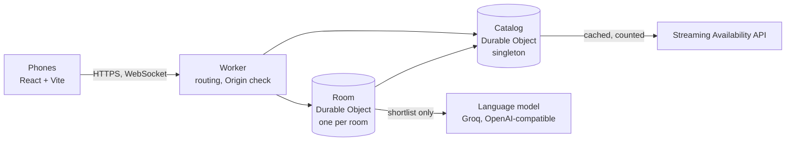

# Truce

**Movie night, settled.** A group can't agree on a film. Everyone joins a room from their own phone with only a nickname, taps a few answers and names three films they love. Truce prints **one film the group can stream tonight in their country**, with a short reason for each person. Each person gets one veto.

**Live:** https://truce.arhamazad2004.workers.dev

## How it works

1. The host opens a room and shares the link or QR code. No accounts.
2. Each person picks a mood, energy, time limit and streaming services, then three favourite films. Nobody sees anyone else's answers in the lobby.
3. The host taps **Settle it**. Truce shortlists films that are on the group's services in their region and fit the shortest time limit, scores them against everyone's favourites, and asks a language model to rank the top ten and write the reasons.
4. Everyone sees the same ticket at the same moment. A veto tears it up and prints the runner-up. The room deletes itself after four hours.

## Architecture



- **Room** holds one room's state and its WebSockets. It sleeps between messages (WebSocket hibernation) and an alarm wipes its storage after four hours.
- **Catalog** is the only code that calls the film data API. It caches trimmed responses, counts requests per day and month, enforces per-client budgets, and answers "Truce is resting" before the free allowance runs out.
- **The pick** is deterministic first: hard filters (streamable, runtime, rating, not already a favourite), then a score that leans on the least-happy person. The model may only reorder that shortlist. Its output is validated, and any failure silently falls back to the deterministic result.

## Engineering notes

- **Runs at $0.** Cloudflare Workers Free, a free film data plan of 1,000 requests a month, and a free model tier. The quota is treated as a design constraint: a shared 30-day search cache, 24-hour candidate cache, about 3 requests per pick, and daily budgets per client.
- **The model can't invent a film.** It receives members as `P1..Pn` with their taps and favourite titles, and candidate ids. It never sees nicknames, tokens or film descriptions. Every film fact on screen comes from the data source.
- **Private by construction.** No accounts, no cookies, no analytics, self-hosted fonts. Per-request logging is off because URLs carry room codes and search text.
- **One message at a time per room.** Handlers that wait on another service can't be overtaken, and room state is always reloaded after an `await`.
- **Security reviewed.** Threat model, an independent review and a pre-launch checklist with evidence are in [`docs/SECURITY_PRIVACY.md`](docs/SECURITY_PRIVACY.md). Content Security Policy allows only the app's own scripts and the poster image host.
- **54 tests** run inside the Workers runtime: room protocol, privacy of state frames, quota guard, rate limits, the pick, and the model step against a fake endpoint.

## Stack

| Part | Choice | Why |
|---|---|---|
| Client | React 19, Vite, plain CSS with design tokens | Three routes and one socket: no router, state library or UI kit needed |
| Server | Cloudflare Workers + Durable Objects (SQLite-backed) | A room is naturally one small stateful object; hibernating WebSockets cost almost nothing when idle |
| Validation | zod, shared between client types and server | The server never trusts a message from a browser |
| Film data | Streaming Availability API by Movie of the Night | Per-country streaming catalogues, and terms that allow this use |
| Ranking | One `fetch` to an OpenAI-compatible endpoint (Groq) | No SDK for a single call; switching provider is three settings |
| Tests | Vitest in the Workers runtime | Tests exercise real Durable Objects and WebSockets |

## Run it locally

```bash
npm install
npm run dev
```

With no API keys the app runs on built-in sample films, so nothing is spent. Keys and deployment are covered in [`docs/SETUP.md`](docs/SETUP.md).

```bash
npm test
npm run typecheck
```

## Documentation

| Doc | What it covers |
|---|---|
| [`docs/PRD.md`](docs/PRD.md) | The problem, the users, scope and success measures |
| [`docs/TRD.md`](docs/TRD.md) | Technical design and verified platform limits |
| [`docs/APP_FLOW.md`](docs/APP_FLOW.md) | Every screen, state and line of copy |
| [`docs/BACKEND_SCHEMA.md`](docs/BACKEND_SCHEMA.md) | Room state, HTTP and WebSocket contract, limits, the pick pipeline |
| [`docs/SECURITY_PRIVACY.md`](docs/SECURITY_PRIVACY.md) | Threat model, data inventory, limits, checklist, privacy notice |
| [`docs/DECISIONS.md`](docs/DECISIONS.md) | 19 decision records with the alternatives considered |
| [`docs/DESIGN_BRIEF.md`](docs/DESIGN_BRIEF.md) | The "Night Ticket" brand book: colour, type, motion, components |

## Known limits

- Streaming coverage depends on the data source. In some countries only a few services are listed.
- "Streamable" means on a service at least one ready member has, because the group watches together.
- Someone with many network addresses could use up a day's film lookups and put the app into its resting state until the next day. Nothing is billed; see the accepted risk in the security doc.
- The host can't hand the room over. If the host leaves for good, open a new room.

## Attribution

Streaming availability metadata and images are provided by [Streaming Availability API by Movie of the Night](https://www.movieofthenight.com/about/api). Posters and service names belong to their owners and are shown only to identify a film.

## Licence

All rights reserved. See [`LICENSE`](LICENSE).
