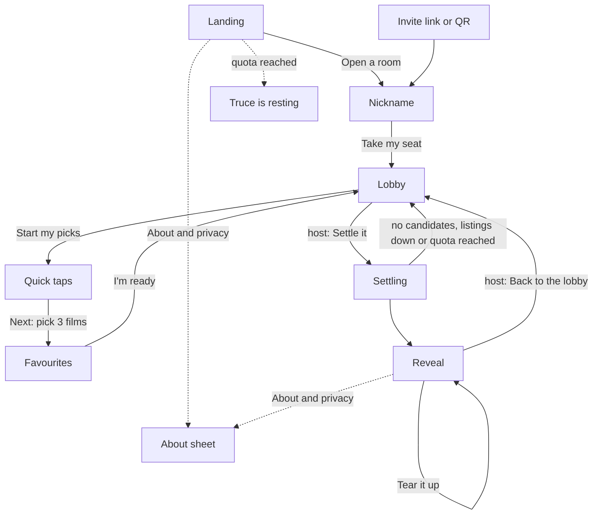
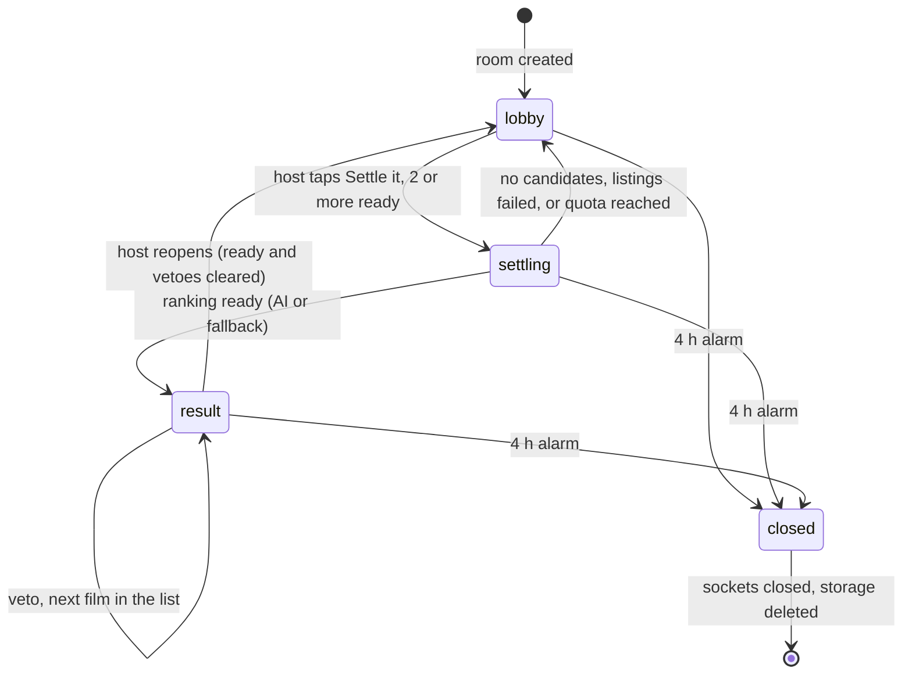

# Truce: App Flow

How a group moves from "what are we watching?" to one film on the screen. Room state, messages and limits are defined in [`BACKEND_SCHEMA.md`](BACKEND_SCHEMA.md); what is stored and for how long is in [`SECURITY_PRIVACY.md`](SECURITY_PRIVACY.md); look and voice follow [`DESIGN_BRIEF.md`](DESIGN_BRIEF.md). A change to the flow updates this file in the same commit.

Copy rules for every line below: a friendly usher. Short, second person, plain verbs. No emoji, no exclamation marks, few em-dashes. Copy marked *(proposed)* has not appeared in a mockup yet.

## 1. Roles

| Role | Who | Can do |
|---|---|---|
| **Host** | Whoever opens the room. Also a member: answers, picks films, gets a reason and a veto. | Everything a guest can, plus change the streaming region (lobby only), tap **Settle it**, and take the room **Back to the lobby** after a result. |
| **Guest** | Anyone who joins from the link, QR code or room code. | Answer, pick favourites, mark ready, veto once. |

Nobody sees anyone else's answers or favourites. The lobby shows only nickname, seat, ready and connected. The reveal shows the current pick and everyone's reason; lower-ranked films are never sent until a veto reaches them.

## 2. Journey

### Host
1. **Landing** → taps **Open a room**.
2. **Nickname** → types a name, taps **Take my seat**. The room is created with the region taken from the host's connection, and the host joins with `join {nickname, hostToken}`, which claims the host seat.
3. **Lobby** → shares the link or QR code, checks the region, taps **Start my picks**.
4. **Quick taps** (step 1 of 2) → mood, energy, time, services.
5. **Favourites** (step 2 of 2) → three films → **I'm ready**. Back to the lobby.
6. **Lobby** → watches seats fill. **Settle it** turns on at two ready.
7. **Settling** → everyone's screen dims together.
8. **Reveal** → one film, one reason per person, one veto each.

### Guest
1. Opens the link or scans the QR code → **Nickname** → **Take my seat**.
2. **Quick taps** → **Favourites** → **I'm ready**.
3. **Lobby** → waits for the host to settle.
4. **Settling** → **Reveal**, same moment as everyone else.

### Timing targets
- Inputs (quick taps + favourites): **under 25 s per person** on a phone.
- Whole flow, link shared to first reveal: **under 60 s for 3 people** (median of timed runs).
- The pick never waits on the AI for more than 12 s in total (one deadline shared by the attempt and its one retry); after that the fallback result is used.

Host and guests both land in the lobby after the nickname: the host so they can share the link first, guests so they can see who is already in.

## 3. Room phases

| Phase | What is happening | What clients show |
|---|---|---|
| `lobby` | Members join (joining is lobby-only), answer, mark ready. Host may change region. A failed settle lands back here with a notice. | Nickname, Lobby, Quick taps, Favourites |
| `settling` | One settle in progress: shortlist from the film listings, scoring, one AI call, validation. Set and saved before the first outbound call. Only one settle runs at a time. | Settling |
| `result` | `ranking[index]` is the pick. Each veto moves `index` on by one. The host can reopen the lobby. | Reveal |
| `closed` | Transient. The 4-hour alarm sets it just before every socket is closed and storage is deleted, so only sockets open at that moment ever see it. | Expired room |

## 4. Screens

Every screen: wordmark lozenge top left, a DM Mono label top right (step, role or ticket line), content on ticket stock, primary button in amber on the room. Attribution sits in the footer of Landing and on every Reveal.

### 4.1 Landing
- **Purpose:** say what Truce does in one breath and open a room.
- **Elements:** title, one-line promise, primary button, a text button for joining by code, footer with attribution and the about link.
- **Primary action:** **Open a room**.
- **Copy:**
  - Title: "Movie night, settled."
  - Sub: "One pick you can all stream, and a reason for each of you." *(proposed)*
  - Primary: "Open a room"
  - Text button: "Got a room code?" → reveals a code field, label "Room no.", button "Join" *(proposed)*
  - Footer: "Streaming data and images: Streaming Availability API by Movie of the Night" (links to https://www.movieofthenight.com/about/api) · "About and privacy"
- **Resting:** when the data quota is used up, `POST /api/rooms` answers `QUOTA_REACHED`. The button is replaced by the resting message (see Edge states).
- **Host vs guest:** guests arriving by link skip this screen and go straight to Nickname.

### 4.2 Join / nickname
- **Purpose:** give the person a name for tonight. No account, no email.
- **Elements:** title, one text field, helper line, primary button. For guests, the room code in a DM Mono label top right.
- **Primary action:** **Take my seat**.
- **Copy:**
  - Title: "Take a seat." *(proposed)*
  - Field label: "Your name for tonight"
  - Helper: "Up to 20 letters or numbers. No account." *(proposed)*
  - Primary: "Take my seat"
- **Rules:** 1–20 characters; letters, digits, space, `- _ '`; unique in the room (see [`BACKEND_SCHEMA.md`](BACKEND_SCHEMA.md)). The member token is kept in `sessionStorage`, never in the URL.
- **Host vs guest:** same screen. For the host, tapping the button also creates the room and sends the `hostToken` with the join. A guest who arrives after the room has left the lobby gets `WRONG_PHASE` and sees "This room has already settled. Ask the host for a new one." *(proposed)*

### 4.3 Lobby
- **Purpose:** gather the group, show who is ready, and let the host settle.
- **Elements:** room ticket (room no. in DM Mono, **Copy invite link**, QR on the stub), share line, region line, seat-row ticket (seat number, nickname, READY stamp or status), bottom action.
- **Primary action:** host: **Settle it**. Guest: **Start my picks** until ready.
- **Copy:**
  - Title: "Box office is open."
  - Ticket label: "Room no." · button "Copy invite link" · after copying: "Link copied." *(proposed)*
  - Under the ticket: "Scan or share. Nickname only, no account."
  - Region: "Streaming region: United Kingdom" · text button "Change" (host only; lists only the countries the film listings cover). Changing it clears everyone's services and ready stamps; members see "The region changed. Pick your services again." *(proposed)*
  - Seat row header: "Row A · 2 of 3 ready"
  - Seat status: stamp "Ready", "Picking films…" while deciding, or "Away"; host row adds "host", own row adds "you"
  - Member not done yet: primary "Start my picks" ("Finish my picks" once they have answers). Ready: text button "Change my picks"
  - Host, fewer than two ready: button disabled, note "Settle it opens when two of you are ready." *(proposed)*
  - Host, two or more ready: "Settle it" · note "Two are ready. The lights go down when you tap."
  - Guest, ready: "You're in. The host settles it when everyone's ready." *(proposed)*
- **Host sees:** "Host" label top right, region **Change**, **Settle it**.
- **Guest sees:** room ticket and share line (anyone can invite), region as plain text, no settle button.
- Presence and ready changes are announced with `aria-live="polite"`.

### 4.4 Quick taps (step 1 of 2)
- **Purpose:** four fast choices. Private to the person.
- **Elements:** ticket with four sections split by perforations: Mood (6 chips, pick one), Energy (3 segments), Time (4 segments), Services (chips, pick any, loaded for the room's region, text labels only).
- **Primary action:** **Next: pick 3 films**, enabled once mood, energy, time and at least one service are set.
- **Copy:**
  - Top right: "Step 1 / 2"
  - Title: "What are you in for?"
  - Sub: "Four taps. Nobody else sees your answers."
  - Labels: "Mood" · "Energy" · "Time" · "Services", each with "Pick one" or "Pick any"
  - Options: Cosy · Funny · Tense · Moving · Mind-bending · Feel-good / Half asleep · Awake · Wired / 90 min · 2 hours · 2½ hours · No limit / Netflix · Prime Video · Disney+ · …
  - Primary: "Next: pick 3 films"
  - No services for the region: "We can't check streaming in this country yet. Ask the host to change the region." *(proposed)*
- **Rules:** services are the ones the film listings cover in the room's region, as text labels. Editing answers after being ready clears the ready stamp until **I'm ready** is tapped again.
- **Host vs guest:** identical.

### 4.5 Favourites (step 2 of 2)
- **Purpose:** three films the person loves. These steer the shortlist and become the hooks for their reason.
- **Elements:** search field (`/api/search`; starts at 3 characters, waits 500 ms after the last keystroke, because every new search spends some of a small monthly allowance), result rows (poster, title, year), three slots on the ticket that fill as films are chosen, each removable.
- **Primary action:** **I'm ready**, enabled at three films. (The server accepts one to three; the UI asks for three.)
- **Copy:** *(all proposed; this screen has no mockup yet)*
  - Top right: "Step 2 / 2"
  - Title: "Three films you love."
  - Sub: "Any year, any genre. They steer the pick."
  - Field label: "Search films" · placeholder "Start typing a title"
  - Slot empty: "Film 1" / "Film 2" / "Film 3" · remove button label "Remove"
  - No results: "Nothing by that name. Try fewer words."
  - Search failed: "Search is slow right now. Try again in a moment."
  - Primary: "I'm ready"
- **Rules:** changing favourites after being ready clears the ready stamp.
- **Host vs guest:** identical. The client sends film ids only; the server takes the title and details from its own copy of the listings.

### 4.6 Settling
- **Purpose:** the short wait while the pick is made. Everyone sees it at once.
- **Elements:** dimming house light, empty printer slot, one status line. No buttons.
- **Copy:** *(proposed)*
  - Title: "House lights going down."
  - Status: "Finding a film you can all stream."
- **Host vs guest:** identical. Late or not-ready members watch the same screen; they are not part of the pick.

### 4.7 Reveal
- **Purpose:** the one big moment. One film, everyone's reason, the veto.
- **Elements:** printer slot, ticket feeding out (poster, title, year · runtime, service tag, serial), "Why this one" with one reason per ready member (bold name lead-in), veto stub with oxblood edge, veto tokens, attribution line. Motion as in [`DESIGN_BRIEF.md`](DESIGN_BRIEF.md) §06; reduced motion shows the finished ticket at once.
- **Primary action:** none forced. The stub offers **Tear it up and use my veto**.
- **Copy:**
  - Top right: "Admit 3 · Tonight" (the count is the number of people in the pick)
  - Service tag: "On Netflix"
  - Section label: "Why this one"
  - Reason: "**Sam:** You picked The Quiet Orbit. This has the same slow-burn wonder."
  - Veto button: "Tear it up and use my veto"
  - Note: "One veto each. Tearing shows the runner-up."
  - Tokens label: "Vetoes left"
  - Footer: "Streaming data and images: Streaming Availability API by Movie of the Night" (linked)
  - Host only, text button under the ticket: "Back to the lobby" *(proposed)*
- **Host vs guest:** identical, except that the host can send the room back to the lobby. Everyone keeps their answers and films; ready stamps and vetoes are cleared.

### 4.8 Veto / runner-up
- **Purpose:** let anyone reject the pick once, without a debate.
- **Flow:** tap **Tear it up and use my veto** → stub tears off, house lights come up for a beat → next film in the ranked list prints on every phone. No new AI call; films past the AI's top 3 come from the score order with template reasons. No film repeats.
- **Copy:** *(proposed)*
  - Line above the new ticket, for everyone: "Leila tore it up. Here's the runner-up."
  - Own stub after using the veto: "You've used your veto." (button gone)
  - Used token: struck through with the word "used" in its label, not colour alone
- **Host vs guest:** identical.

### 4.9 About and privacy sheet
- **Purpose:** plain-language privacy notice and credits. Opens over any screen from "About and privacy".
- **Copy:** *(proposed; must match [`SECURITY_PRIVACY.md`](SECURITY_PRIVACY.md))*
  - Title: "About Truce"
  - "Truce picks one film your group can stream tonight."
  - "No accounts. We keep your nickname, your taps and your three films for this room only. The room and everything in it is deleted after 4 hours."
  - "Your nickname never leaves our server. The film-ranking model only sees your taps and film titles, labelled P1, P2 and so on."
  - "No ads, no analytics, no tracking."
  - "Streaming availability metadata and images are provided by Streaming Availability API by Movie of the Night." The name links to https://www.movieofthenight.com/about/api. No logo.
  - Close button: "Close"

## 5. Edge states

| Situation | What happens | Copy shown |
|---|---|---|
| **Reconnect** | Socket drops; client retries with backoff and resumes with its token. Seat shows as away to others. | Strip on the room: "Lost the signal. Reconnecting…" → "Back in." After repeated failures: "Still can't reach the room. Check your connection." with button "Try again" *(proposed)* |
| **Refresh / resume** | Same tab: token in `sessionStorage` sends `resume`; the person keeps their seat, answers and veto. No message. A new tab or another device has no token and joins as a new person. | None on success |
| **Host disconnects** | Room keeps running. Guests can still answer and ready up. Only the host can settle, so the room waits for them to resume with their token. | Host's seat: "away". Guest bottom note: "Sam stepped out. The room waits for the host to settle it." *(proposed)* |
| **Room full (8)** | `ROOM_FULL` on join. | "This room is full. All eight seats are taken." *(proposed)* |
| **Name taken** | `NAME_TAKEN` on join; field keeps the text. | Under the field: "Someone here is already Leila. Add an initial?" *(proposed)* |
| **Expired room (4 h)** | Alarm fires: sockets closed with `EXPIRED`, storage deleted. People still on the page see this screen. | Title "The lights are up." · "This room closed after 4 hours. Open a new one to pick again." · button "Open a room" *(proposed)* |
| **Invalid link** | Unknown code returns a plain 404 and creates nothing. An expired room that has been deleted looks the same, so the copy covers both. | Title "No room here." · "The link may be wrong, or the room has closed." · button "Open a room" *(proposed)* |
| **Joining late** | `join` outside the lobby returns `WRONG_PHASE`. | "This room has already settled. Ask the host for a new one." *(proposed)* |
| **No candidates** | The pick relaxes on its own first: one more page of films, runtime +20 min, then mood genres dropped. If still empty: `NO_CANDIDATES`, back to `lobby` with a notice everyone sees. Answers are kept; the host can settle again (up to 5 attempts per room). | Host and guests: "Nothing fits everyone yet. Loosen a filter: more time, another service, or a different region." *(proposed, from the plan's "loosen a filter")* |
| **AI fallback** | AI error, invalid output, 429, timeout or the 12 s deadline → deterministic ranking with template reasons, `source: "fallback"`. | None. The reveal looks the same. |
| **Listings outage** | The data source does not answer during settling → `PICK_FAILED`, back to `lobby`; host can try again. | Host: "The film listings didn't answer. Try again in a minute." · button "Settle it". Guests: "The film listings didn't answer. The host can try again." *(proposed)* |
| **Quota reached** | The daily soft cap or the monthly limit on film lookups is used up (`QUOTA_REACHED`, scope `day` or `month`). Search and new rooms stop; a settle in an open room returns to `lobby`. Rooms keep their state until they expire. | Landing and lobby: title "Truce is resting." · "We've used up this month's film lookups. Back next month." or "…today's film lookups. Back tomorrow." Search field: "Search is resting. Back tomorrow." *(proposed)* |
| **All vetoes used** | Every member has vetoed. Current film stands. | Stub: "No vetoes left. This is tonight's film." *(proposed)* |
| **List exhausted** | A veto would move past the last streamable film. The host's **Back to the lobby** (`reopen`) is the way out: answers and films are kept, ready stamps and vetoes are cleared. | Everyone: "That's everything you can all stream." Host: button "Back to the lobby". Guests: "The host can reopen the lobby so you can loosen a filter." *(proposed)* |
| **Out of settle attempts** | Five settles have been tried in this room. | Host: "This room has had its five tries. Open a new one." *(proposed)* |
| **Too many messages** | Over 20 messages in 10 s; socket closed with `RATE_LIMITED`, client reconnects. | "Easy there. Reconnecting…" *(proposed)* |

## 6. Settled points and accepted limits

Decided on 2026-11-16 and written into [`BACKEND_SCHEMA.md`](BACKEND_SCHEMA.md):

1. **Settle retries.** One settle runs at a time. A failed settle (no candidates, listings outage, quota) returns the room to the lobby with a message. At most 5 attempts per room.
2. **After a result.** The host can send `reopen` to return to the lobby. Members, answers and favourites stay; ready stamps and vetoes are cleared.
3. **Host seat.** The host's first socket message is `join {nickname, hostToken}`.
4. **Joining after settle.** Joining is lobby-only (`WRONG_PHASE` otherwise).
5. **Region change.** Clears everyone's services and ready stamps.
6. **Editing after ready.** Changing answers or favourites clears that member's ready stamp.
7. **Ready.** Needs answers and one to three favourites; the UI asks for three.
8. **`closed` phase.** Transient: set by the expiry alarm just before storage is deleted.

Accepted for v1:

- **Same person, new tab.** Their old seat still holds the nickname, so rejoining hits "name taken". The seat frees when the room closes.
- **No host handover.** If the host never returns, the room cannot settle.
- **Reopen during the reveal.** The host can pull everyone back to the lobby at any time after a result; there is no confirmation step.
