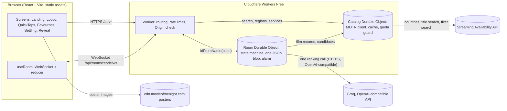

# Truce — Technical Requirements (TRD)

How Truce is built, what it costs in free-tier quota, and how it is tested and shipped. Protocol and data shapes live in [BACKEND_SCHEMA.md](BACKEND_SCHEMA.md); threats and data handling in [SECURITY_PRIVACY.md](SECURITY_PRIVACY.md).

Film and streaming data come from the **Streaming Availability API by Movie of the Night** ("MOTN"). Why it replaced the first data source is in [DECISIONS.md 016](DECISIONS.md).

## 1. Architecture

One room = one Durable Object instance, addressed by the room code. The Worker is stateless: it serves the app, applies rate limits, and hands WebSocket upgrades to the room. The room owns the state machine (`lobby → settling → result`, `closed` at expiry), persists one JSON blob, and deletes itself by alarm after 4 hours. Sockets use the hibernation API, so an idle room costs nothing.

The **Catalog** is one shared Durable Object. It is the only place that calls MOTN, so the cache and the request counters are global and exact. MOTN's free plan allows 1,000 requests a month; every design choice in section 3 follows from that.

## 2. Stack and reasons

| Choice | Why | Security note |
|---|---|---|
| TypeScript everywhere | One language and shared types for client, Worker and protocol | Fewer shape mismatches at the trust boundary |
| React + Vite | Known tools, fast dev loop, small bundle with no router or state library | React escapes text by default; no `dangerouslySetInnerHTML` |
| Cloudflare Workers + static assets | Free tier, global, one deploy for app and API | Secrets stay server-side; same origin, so no CORS surface |
| Durable Objects (SQLite-backed, KV API) | A live room needs one consistent place for state and sockets; Free plan supports SQLite-backed objects only | Single-threaded per room, so no races between members |
| One Catalog Durable Object | A global cache and an exact request counter without adding another storage product | One code path holds the data key's use; the caps cannot be raced |
| `@cloudflare/vite-plugin` | One `npm run dev` runs client, Worker and both objects together | Dev matches production runtime |
| `zod` | One schema validates messages and generates the types | Every inbound message, every MOTN response and every AI output is validated |
| One `fetch` to Groq's OpenAI-compatible endpoint (no SDK, see `DECISIONS.md` 019) | Provider switch is three env vars | Key never leaves the Worker |
| Groq `openai/gpt-oss-20b` | Free tier, fast, supports strict JSON schema output | Receives no personal data, no free text and no film descriptions |
| Streaming Availability API (MOTN) | Films and per-country streaming options in one call; terms allow this use, including sending a shortlist to a model for ranking, and allow caching | Films are copied from the server's cache by id, never trusted from the client; its terms bar training or evaluating models on the data, which Truce does not do |
| `uqr` (or similar zero-dependency QR) | QR drawn locally | Room link is not sent to a QR service |
| Plain CSS with tokens, self-hosted fonts | The design is small; tokens come straight from the brief | No third-party CSS or font host; the CSP stays `'self'` |

Deliberately skipped until needed: router, state library, UI kit, Tailwind, SQL schema, diff sync, Turnstile, global AI quota counter, Playwright, auto-deploy from CI.

## 3. Free-tier budget

Limits checked on 2026-11-16 (sources in section 10). Usage figures are estimates until measured in Phases 5 to 9.

### 3.1 MOTN requests (the tightest limit)

Free plan: **1,000 requests a month**, 1 GB of image bandwidth a month. At the limit, access stops until the next cycle; there are no overage charges.

| Step | MOTN requests | Why so few |
|---|---|---|
| Countries and services | 1 a week for the whole app | `GET /countries` returns every country with its services; cached 7 days |
| Favourite search | 1 per **uncached** query. Estimate 5 per person (3 films, a retyped word or two) | 3-character minimum, 500 ms debounce, 30-day cache shared by all rooms |
| Choosing a favourite | 0 | The film record was cached when it appeared in a search result |
| Settle | 3 (two pages of mood genres, one page of favourite genres). Up to 5 with the relaxation ladder | One filter call returns 20 films with their streaming options; pages are cached 24 h, so a retry or a similar room costs 0 |
| Veto, reopen, reveal | 0 | Everything needed is already in the room |

| Room of 3 | Requests |
|---|---|
| Typical | 15 search + 3 settle = **about 18** |
| Planning figure (retyping, one relaxed settle) | **25** |
| Worst case (9 searches each, relaxed settle) | about 32 |

**Monthly capacity:** 950 usable requests (50 held back) ÷ 25 = **about 38 rooms a month**; closer to 50 if searches hit the cache. Compare the first design, which needed about 35 upstream calls for one settle alone.

**Quota guard** (in the Catalog):
- Soft cap of **120 requests per UTC day**, so one bad day cannot burn the month. Search stops at 100, leaving 20 so rooms already open can still settle.
- Monthly cap of 950.
- Over a cap, or on a 429 from MOTN: search, room creation and settle return `QUOTA_REACHED`, and the app shows "Truce is resting until tomorrow" or "until next month". Open rooms keep their state.
- After an upstream 429 the Catalog stops calling for 6 hours, then tests with one request.

**Image bandwidth:** posters load straight from MOTN's CDN at 240 px (search rows) and 360 px (reveal). Rough estimate 2 to 3 MB per room, so the 1 GB allowance covers several hundred rooms; the request limit bites first. What MOTN does when image bandwidth runs out is **not verified**; the poster slot has a typographic placeholder for any failed image.

**Development:** With no `MOTN_API_KEY` set, the Catalog answers from hand-written sample data (`worker/fixtures.ts`), so local runs, tests and CI never spend the 1,000 monthly requests. Add the key to `.dev.vars` only when you need real data.

### 3.2 Per settle (one Durable Object invocation)

| Item | Use | Limit | Notes |
|---|---|---|---|
| Room → Catalog calls | 3 to 6 | | Each cache miss is one MOTN fetch inside the Catalog's own invocation |
| AI calls | 1, or 2 on a validation retry | | Share one 12 s deadline |
| **Subrequests from the room** | **≤ 8** | **50 per invocation** | The Workers Cache API is not used: its calls count against the same 50, and the Catalog's storage does the job globally |
| Simultaneous outbound connections | 1 to 2 | 6 | Candidate pages are fetched in sequence (page 2 needs page 1's cursor) |
| AI tokens | about 1.2K prompt + up to about 1K output and reasoning (estimate) | 8K tokens per minute | A retry roughly doubles it |

### 3.3 Per day (Cloudflare and Groq)

| Resource | Limit | Estimated use per room (4 people) | Rooms per day |
|---|---|---|---|
| MOTN requests | 120 (own soft cap) | about 25 | **about 4 to 6** |
| Worker requests | 100,000 | about 50 (WS upgrades, search keystrokes, services, create). Static assets are free | about 2,000 |
| DO rows written | 100,000 | about 60 (room mutations, cache entries, counters; `setAlarm` counts as one) | about 1,500 |
| DO requests | 100,000 | about 40 (WS connects, alarm, Catalog calls; incoming messages are counted at 20:1 for billing) | 2,500+ |
| DO duration | 13,000 GB-s | under 2 (hibernates when idle) | 6,000+ |
| Groq requests | 1,000 (not verified for the free tier, see section 10) | 1 to 2 | about 500 |
| Groq tokens | 200,000 (same caveat) | about 2.2K | about 80 |

**Headroom:** MOTN is the first limit by a wide margin: a handful of rooms a day and about 38 a month. That suits a portfolio demo and nothing bigger. Past the cap the app rests with a clear message; nothing is billed. Groq is next: on a 429 the room falls back to the deterministic pick with no visible error.

## 4. Pick pipeline (summary)

Detail, parameters and the AI contract: [BACKEND_SCHEMA.md §7 to §10](BACKEND_SCHEMA.md#7-data-source-catalog-object-and-motn-calls).

1. **Group inputs:** union of services, lowest time limit, union of mood genres, everyone's favourites (already in the room).
2. **Candidates:** three filter-search pages (about 60 films) for the room's country, the union of services as `subscription` or `free`, movies only, rating ≥ 60.
3. **Hard filters:** streamable on a chosen service in the region, runtime within the limit (checked after fetch; MOTN has no runtime filter), released, not a favourite. Nothing later can override these.
4. **Score:** per-member affinity from genres, directors, cast and era of their favourites; group score `0.6·min + 0.4·mean`, plus mood/energy fit and a small quality term → top 10.
5. **AI rank:** one call ranks 3 of the 10 and writes one reason per member per film. It sees title, year, genres, runtime and service names only.
6. **Validate:** ids, members, lengths, characters. One retry on a validation failure, inside one shared 12 s deadline.
7. **Fallback:** score order with template reasons. Used on any AI failure, and whenever `AI_API_KEY` is unset.
8. **Veto:** move to the next entry; extend lazily from score order. No upstream call.
9. **Failure:** no candidates, data source down or quota reached → back to `lobby` with a message; the host can try again (one settle at a time, 5 attempts per room). After a result, the host can `reopen` the lobby.

`phase = "settling"` is persisted before the first outbound call, because awaiting releases the object's input gate and a second "settle" could otherwise slip in.

## 5. Config and environment

| Name | Kind | Where | Purpose |
|---|---|---|---|
| `MOTN_API_KEY` | secret | `.dev.vars` / `wrangler secret put` | Streaming Availability API key from developers.movieofthenight.com (sent as `X-API-Key`) |
| `AI_API_KEY` | secret | same | Groq key. **If unset, the AI step is skipped and the fallback is used** (kill switch) |
| `AI_BASE_URL` | var | `wrangler.jsonc` | `https://api.groq.com/openai/v1` |
| `AI_MODEL` | var | `wrangler.jsonc` | `openai/gpt-oss-20b` |
| `ROOM` | DO binding | `wrangler.jsonc` | `Room` class, `new_sqlite_classes` migration |
| `CATALOG` | DO binding | `wrangler.jsonc` | `Catalog` class, same migration list |
| `RL_CREATE`, `RL_SEARCH`, `RL_WS` | rate-limit bindings | `wrangler.jsonc` `ratelimits` | 5, 30 and 20 per 60 s |
| `ASSETS` | assets binding | `wrangler.jsonc` | `not_found_handling: "single-page-application"`, `run_worker_first: ["/api/*"]` |

Limits, caps and enums are constants in `shared/limits.ts` and `shared/protocol.ts`, not environment variables.

## 6. Testing strategy

Vitest with `@cloudflare/vitest-pool-workers`, so tests run in the real Workers runtime with real Durable Object storage.

| Layer | What | Examples |
|---|---|---|
| Unit | Pure functions in `shared/` and `worker/pick/` | Nickname normalisation; hard filters; scoring; relaxation ladder; AI output validation; template reasons; trimming a MOTN show (overview dropped, poster host checked) |
| Room integration | The `Room` object through its real interface | Join with and without `hostToken`, resume, duplicate nickname, room full, bad message, wrong phase, join after lobby, non-host settle, veto once, reopen, region change clears services, expiry alarm, double-settle race, failed settle returns to lobby |
| Catalog integration | The `Catalog` object with a mocked `fetch` | Cache hit costs no fetch; daily and monthly caps; search cap leaves the settle reserve; upstream 429 opens the 6 h pause; unknown film id returns nothing |
| Fixtures | Recorded MOTN JSON, trimmed, in `test/fixtures/` | Deterministic pick end to end with no network |
| AI client | Injected fake `fetch` | Valid, hallucinated id, missing member, over-long reason, 429, timeout, deadline spent before the retry |

Not yet: Playwright or any browser end-to-end test. The phone flow is checked by hand (two phones in Phase 4, three in Phase 10). Tests never call MOTN or Groq.

## 7. Deployment and CI

- **Local:** `npm i`, `npm run dev`, `npm test`.
- **Deploy:** `npx wrangler deploy` by hand to `*.workers.dev`. Optional custom domain in Phase 10.
- **Secrets:** `npx wrangler secret put MOTN_API_KEY` and `AI_API_KEY`. Never in the repo or the client bundle.
- **CI (GitHub Actions):** typecheck, lint, test, build on every push and pull request. CI holds no Cloudflare or API credentials and does not deploy.
- **Release check:** `npm audit`, grep `dist/` for key patterns, tick the [pre-launch checklist](SECURITY_PRIVACY.md#8-pre-launch-checklist).

## 8. Observability

- Workers Logs (Free plan) with structured `console.log` lines: event name, phase, member **count**, pick `source`, MOTN requests used today and this month, cache hit or miss, upstream status codes, durations.
- **Never logged:** nicknames, tokens, room codes, IP addresses, answers, favourites, search text, AI prompts or outputs.
- No client analytics, no error-reporting SDK.
- Health: `GET /api/health` returns 200. Quota: MOTN, Cloudflare and Groq dashboards, checked by hand; MOTN also emails near the limit.

## 9. Performance targets

| Target | Value |
|---|---|
| Create room → reveal, 3 people (median) | < 60 s |
| One member's inputs on a phone | < 25 s |
| Settle, AI path (median) | < 6 s |
| Settle, worst case | 12 s shared AI deadline plus the candidate fetches (target under 3 s uncached), then the fallback |
| Presence update to other phones | < 300 ms |
| Search response (cached / uncached) | < 150 ms / < 800 ms (uncached figure not measured yet) |
| WebSocket message size | ≤ 2 KB inbound |
| Worker CPU per request | well under the Free plan's 10 ms (routing and validation only) |
| Client bundle | under 150 KB gzipped (react, zod, QR, app code), fonts separate |
| Lighthouse (mobile) | Performance and Accessibility ≥ 90 |

## 10. Verified platform facts

Checked 2026-11-16 against the official pages below.

| # | Question | Finding | Source |
|---|---|---|---|
| 1 | Subrequests per invocation on Workers Free | **50.** Each redirect hop counts. Cache API calls share the same quota. A separate row lists 1,000 "subrequests to internal services" on Free, but the page does not say which bindings that covers, so whether Durable Object calls fall under it is **not verified**. The plan's ≤ 8 per settle fits either way | https://developers.cloudflare.com/workers/platform/limits/ |
| 1b | Other Free limits used above | 100,000 requests/day; 10 ms CPU per HTTP request; 6 simultaneous connections. DO Free: 100,000 requests/day, 13,000 GB-s/day, 5M rows read/day, 100,000 rows written/day, 5 GB; SQLite-backed only; `setAlarm()` is one row written | https://developers.cloudflare.com/durable-objects/platform/pricing/ |
| 2 | Rate Limiting binding on the Free plan | The binding is generally available (since September 2025) and configured with a `ratelimits` array (Wrangler 4.36.0+). Period must be 10 or 60 s. Counts are approximate, eventually consistent and per Cloudflare location. **Free-plan availability is not stated** on the binding page, the pricing page or the GA changelog: not verified. Test with a deploy in Phase 9 | https://developers.cloudflare.com/workers/runtime-apis/bindings/rate-limit/ · https://developers.cloudflare.com/changelog/post/2025-09-19-ratelimit-workers-ga/ |
| 3 | Groq `openai/gpt-oss-20b` and `json_schema` strict | **Supported.** The model is in the `strict: true` list. Strict mode needs every property in `required` and `additionalProperties: false` on every object; streaming and tool use are not available with it. `json_object` works on all models but only guarantees valid JSON | https://console.groq.com/docs/structured-outputs |
| 3b | Groq rate limits for the model | The page's table shows 30 RPM, 1K RPD, 8K TPM, 200K TPD, but the text read describes it as Developer-plan base limits. Free-tier values: **not verified**; confirm in the Groq console | https://console.groq.com/docs/rate-limits |
| 4 | MOTN plan and terms | Free plan: 1,000 requests and 1 GB image bandwidth a month, no card, access paused at the limit, no overage. Commercial and consumer use allowed. Caching allowed. Barred: training, fine-tuning, evaluating or improving ML/AI systems with the data; reselling it; building a competing API; getting round limits. Attribution required. Details in [SECURITY_PRIVACY.md §9](SECURITY_PRIVACY.md#9-third-party-terms) | https://developers.movieofthenight.com/terms-and-conditions · https://www.movieofthenight.com/about/api/pricing |
| 5 | MOTN base URL and auth | `https://api.movieofthenight.com/v4`, header `X-API-Key` | https://docs.movieofthenight.com/guide/authentication |
| 6 | MOTN endpoints | `GET /shows/{id}`, `GET /shows/search/filters`, `GET /shows/search/title`, `GET /shows/top`, `GET /countries`, `GET /countries/{country-code}`, `GET /genres`, `GET /changes` | https://docs.movieofthenight.com/resource/shows · /resource/countries · /resource/genres |
| 7 | Filter search parameters | `country` (required), `catalogs` (up to 32, `service`, `service.type` or `service.addon.id`; types `subscription`, `free`, `rent`, `buy`, `addon`), `show_type`, `genres`, `genres_relation` (default `and`), `rating_min`, `rating_max`, `year_min`, `year_max`, `keyword`, `show_original_language`, `order_by` (`original_title`, `release_date`, `rating`, `popularity_alltime`, `popularity_1year`, `popularity_1month`, `popularity_1week`), `order_direction`, `cursor`, `series_granularity`, `output_language`. 20 movies per page. **No runtime filter** | https://docs.movieofthenight.com/resource/shows |
| 8 | Title search | `title` and `country` required, `show_type` optional; up to 20 results; no pagination; results may include films not streamable in the country | same |
| 9 | Show fields | `id` (string), `imdbId` and one other external id, `title`, `overview`, `releaseYear`, `originalTitle`, `genres[{id,name}]`, `directors[]`, `cast[]`, `rating` (0 to 100), `runtime` (minutes, nullable), `imageSet`, `streamingOptions` (by country: `service`, `type`, `link`, `videoLink`, `quality`, `expiresSoon`, `expiresOn`, `availableSince`). No adult flag and no keywords list are documented | same |
| 10 | Images | Posters on `https://cdn.movieofthenight.com/…?Expires=…`; vertical posters at widths 240, 360, 480, 600, 720; URLs valid 6 to 12 months. Service logos are on `media.movieofthenight.com` (not used by Truce) | https://docs.movieofthenight.com/guide/images |
| 11 | UAE coverage | Listed with country code `ae`: Netflix, Prime Video, Apple TV, Mubi, Curiosity Stream, Crunchyroll, Zee5. Read from the docs page, not from a live `/countries` call. Regional services such as Shahid, OSN+ and StarzPlay are **not** listed, and Disney+ is not listed for `ae` | https://docs.movieofthenight.com/guide/countries-and-services |
| 12 | Genres | 21 ids: `action`, `adventure`, `animation`, `comedy`, `crime`, `documentary`, `drama`, `family`, `fantasy`, `history`, `horror`, `music`, `mystery`, `news`, `reality`, `romance`, `scifi`, `talk`, `thriller`, `war`, `western` | https://docs.movieofthenight.com/resource/genres |

**Still to verify with a real key (Phase 5):** the status code and body MOTN returns at quota; whether the billing cycle is the calendar month; any per-second limit; the exact `imageSet.verticalPoster` key names beyond `w240`; the service object's field for supported streaming types; that the show id is always a short alphanumeric string; that title search results do not depend on `country`; what happens when image bandwidth runs out.

If the rate-limit binding turns out not to work on Free, the fallback is a small fixed-window counter per IP held in memory in the Worker isolate (approximate, resets on eviction), plus the per-socket caps the room already enforces.
